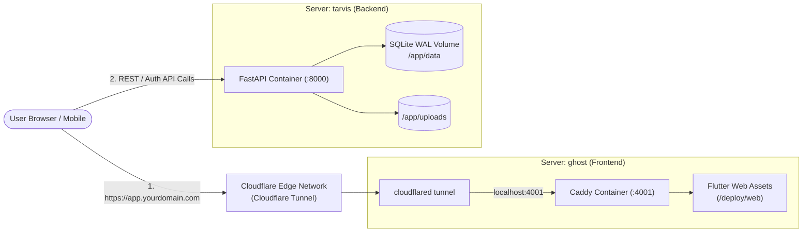

# ChargeBridge Multi-Server Deployment Guide

This guide details how to deploy:
- **Backend API Server (`tarvis`)**: FastAPI, SQLite WAL, Argon2 auth, Uvicorn in Docker on port `8000`.
- **Frontend App Server (`ghost`)**: Flutter Web SPA served via **Caddy on port `4001` (No Nginx)**, ready for **Cloudflare Tunnel**.



---

## 1. Deploy Backend to `tarvis` (Docker Server)

### Step 1.1: Copy Code or Git Clone on `tarvis`
```bash
git clone <your-repo-url> /opt/chargebridge
cd /opt/chargebridge
```

### Step 1.2: Launch Backend Container
```bash
chmod +x deploy/deploy-tarvis.sh
./deploy/deploy-tarvis.sh
```

*(Alternatively, run manually via Docker Compose):*
```bash
mkdir -p data uploads
docker compose -f deploy/docker-compose.tarvis.yml up -d --build
docker exec chargebridge-backend python seed.py
```

### Step 1.3: Verify Backend on `tarvis`
```bash
curl http://localhost:8000/health
# Returns: {"status":"ok","app":"ChargeBridge API","version":"1.0.0"}
```
Make sure port `8000` is accessible from `ghost` or via Cloudflare Tunnel.

---

## 2. Deploy Frontend to `ghost` (Port 4001 via Cloudflare Tunnel)

### Why Caddy instead of Nginx?
- Single lightweight container (`caddy:2-alpine`).
- Built-in SPA routing (`try_files {path} /index.html`) so Flutter routes like `/charger/1` and `/session/101` don't return 404s.
- Automatic zstd & gzip compression.
- Binds cleanly to **`http://localhost:4001`**, making it the target for your Cloudflare Tunnel.
- The pre-compiled Flutter Web bundle is tracked directly in `deploy/web/`, so `git pull` on `ghost` pulls all files immediately — **no missing build cache key error!**

### Step 2.1: Pull Code on `ghost`
```bash
git clone <your-repo-url> /opt/chargebridge-frontend
cd /opt/chargebridge-frontend
```
*(If already cloned, just run `git pull`)*

### Step 2.2: Launch Frontend Container on Port 4001
Run the launch script:
```bash
chmod +x deploy/deploy-ghost.sh
./deploy/deploy-ghost.sh
```
Or directly with Docker Compose:
```bash
docker compose -f deploy/docker-compose.ghost.yml up -d
```

### Step 2.3: Verify Locally on `ghost`
```bash
curl -I http://localhost:4001
# Returns HTTP 200 OK
```

---

## 3. Connect Cloudflare Tunnel on `ghost`

In your Cloudflare Zero Trust dashboard or CLI on `ghost`:

### Option A: Via Cloudflare Zero Trust Dashboard
1. Go to **Networks** &rarr; **Tunnels** &rarr; select or create your tunnel on `ghost`.
2. Add a **Public Hostname**:
   - **Subdomain / Domain**: e.g. `app.yourdomain.com` (or `ev.yourdomain.com`)
   - **Service Type**: `HTTP`
   - **URL**: `localhost:4001` (or `127.0.0.1:4001`)
3. Save the hostname. Cloudflare will automatically route HTTPS traffic to your Flutter app running on port 4001!

### Option B: Via `cloudflared` CLI on `ghost`
In your `~/.cloudflared/config.yml`:
```yaml
tunnel: <YOUR-TUNNEL-UUID>
credentials-file: /root/.cloudflared/<YOUR-TUNNEL-UUID>.json

ingress:
  - hostname: app.yourdomain.com
    service: http://localhost:4001
  - service: http_status:404
```
Then start the tunnel daemon:
```bash
cloudflared tunnel run
```

---

## 4. Rebuilding Flutter Web (When You Update Code)

When you make changes to Flutter code on your development computer, compile and sync to `deploy/web`:
```bash
cd app
flutter build web --release --dart-define=API_URL=https://api.yourdomain.com
cd ..
# Copy build to deploy/web
cp -r app/build/web/* deploy/web/
git add deploy/web && git commit -m "update web release" && git push
```
Then on `ghost`:
```bash
git pull
# Caddy immediately serves the updated files (no container restart even needed!)
```
